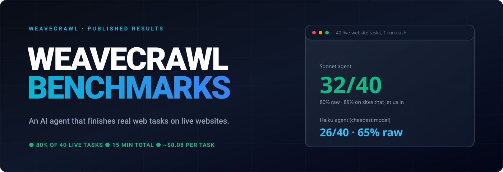

# WeaveCrawl Benchmarks

**Published results for [WeaveCrawl](https://weavecrawl.com).** Every number here links to the run report it came from.

## In plain words

WeaveCrawl lets an AI assistant use a real web browser the way a person does: open a site, read it, click, search, and report back. We tested it on **40 everyday tasks on real, live websites** (find a flight price, check a GitHub issue, look up a recipe or a course). The tasks are a fixed sample of a well-known public test called WebVoyager. A second AI checks every answer.

**Everything is open here:** [the 40 tasks](tasks/README.md) · [the result of every task, with the reason](results/per-task-results.md) · [how it works and what we changed from WebVoyager](docs/methodology.md) · [the code that ran it](harness/README.md) · [the numbers as data](data/official_benchmarks.json)

## Latest numbers

**Latest run: 2026-10-26, Sonnet in the WeaveCrawl desktop app on a person's own Mac.**

| | Score | 95% range |
| :-- | :--: | :--: |
| **Headline: tasks finished correctly, without blocked or held tasks (33 of 38)** | **86.8%** | 72.7–94.2% |
| Raw: all 40 tasks, as run (33 of 40) | 82.5% | 68.0–91.3% |

Which tasks are left out of the headline, and why: **2 of 40**. One task is held for a person on purpose (Amazon--15, the product stops and asks a person). One task cannot be done from our test address (Allrecipes--5: the site blocks it). Nothing else is left out. No bot wall and no broken site stopped any task in this run. Full list per run: [per-task results](results/per-task-results.md).

All published runs (headline = without bot walls, broken sites and held tasks; raw beside it):

| Run | Model | Headline | Raw | Time for 40 tasks | Cost (equivalent) | Report |
| :-- | :-- | :--: | :--: | :--: | :--: | :-- |
| 2026-10-26, desktop app (latest) | Sonnet | **86.8%** (33 of 38) | 82.5% (33 of 40) | 25 min | $3.34 | [report](results/2026-10-26/webvoyager-sonnet-desktop-2-summary.md) |
| 2026-10-26, desktop app (earlier) | Sonnet | **84.6%** (33 of 39) | 82.5% (33 of 40) | 29 min | $3.42 | [report](results/2026-10-26/webvoyager-sonnet-desktop-summary.md) |
| 2026-10-25, your own Chrome | Sonnet | **86.5%** (32 of 37) | 80.0% (32 of 40) | 27 min | $3.62 | [report](results/2026-10-25/webvoyager-sonnet-chrome-summary.md) |
| 2026-10-25, server browser | Sonnet | **88.9%** (32 of 36) | 80.0% (32 of 40) | 15 min | $3.06 | [report](results/2026-10-25/webvoyager-sonnet-summary.md) |
| 2026-10-25, server browser | Haiku | **76.5%** (26 of 34) | 65.0% (26 of 40) | 22 min | $0.29 | [report](results/2026-10-25/webvoyager-haiku-summary.md) |
| 2026-10-24, server browser (first run) | Sonnet | **78.4%** (29 of 37) | 72.5% (29 of 40) | 16 min | $3.05 | [report](results/2026-10-24/webvoyager-sonnet-summary.md) |
| 2026-10-24, server browser (first run) | Haiku | **72.2%** (26 of 36) | 65.0% (26 of 40) | 25 min | $0.35 | [report](results/2026-10-24/webvoyager-haiku-summary.md) |

Sonnet is the stronger model, Haiku the cheaper one. Cost is the price the AI vendor's tool reports for the model use; it was not billed (run on a subscription). The desktop-app and Chrome rows ran on a person's own Mac with their own sign-ins, so they are not directly comparable with the server-browser rows.

**What this means:** with WeaveCrawl, the stronger model finishes about 4 in 5 real web tasks on its own as run, and close to 9 in 10 once tasks that a bot wall, a broken site or a deliberate stop for a person got in the way are set aside. The cheaper model finishes about 3 in 4 of those for about a cent a task.

**What changed between the two desktop runs:** same score, about 8% fewer steps (302 instead of 328) and about 15% less time (25 min instead of 29). The newer release returns a page's outline in the same step that opens the page.

**What changed since the first run (2026-10-24):** WeaveCrawl now waits properly for a page to finish loading its content, and Amazon's "automated access" page now counts as a bot wall instead of an ordinary failure. Same 40 tasks, same setup.

## In the desktop app (2026-10-26)

We ran the same 40 tasks with Sonnet in the WeaveCrawl desktop app, on a person's own Mac, twice on 2026-10-26: first with the 2026-10-25 release, then with a newer release where opening a page also returns its outline in the same step.

| | Earlier run | Latest run |
| :-- | :--: | :--: |
| **Headline (without held and blocked tasks)** | **84.6%** (33 of 39), range 70.3–92.8% | **86.8%** (33 of 38), range 72.7–94.2% |
| Raw (all 40 tasks) | 82.5%, range 68.0–91.3% | 82.5%, range 68.0–91.3% |
| Marked wrong by the judge | 5 (and 1 with no final answer before the time limit) | 6 |
| Held for a person, on purpose | 1 (Amazon) | 1 (Amazon) |
| Agent steps, all 40 tasks | 328 | 302 (about 8% fewer) |
| Working time, all 40 tasks | 29 min (about 44 s a task) | 25 min (about 37 s a task, about 15% less) |
| Cost | $3.42 equivalent | $3.34 equivalent |
| Report | [earlier](results/2026-10-26/webvoyager-sonnet-desktop-summary.md) | [latest](results/2026-10-26/webvoyager-sonnet-desktop-2-summary.md) |

Each run's own validity check passed. One run each; not directly comparable with the server-browser runs (a real Mac with its own sign-ins).

## In your own Chrome

We also ran the same 40 tasks with the stronger model (Sonnet) inside a person's own Chrome, through the WeaveCrawl Chrome extension, on 2026-10-25 (after the release that day).

- **Tasks finished correctly: 32 of 40 (80%)**, range 65.2–89.5%. On the server browser the same tasks also scored 80%.
- Ignoring sites we could not do (2 tasks) and the one task held for a person (Amazon, held on purpose): **32 of 37 (86.5%)**, range 72.0–94.1%.
- 7 tasks were marked wrong by the judge. The run's own validity check passed.
- Working time for all 40 tasks: 27 min (about 41 s per task).
- Cost: $3.62 equivalent (run on a subscription, not billed).

One run only. The numbers are not directly comparable with the server-browser table above (a real browser with its own sign-ins). Report: [Sonnet in Chrome](results/2026-10-25/webvoyager-sonnet-chrome-summary.md).

## How to read this

| Term | Meaning |
| :-- | :-- |
| **Headline score** | Passed tasks ÷ tasks, without the tasks a bot wall blocked, a broken site stopped, or the product held for a person on purpose, and without a task we marked in advance as not doable from our address that did not pass. Every task left out is named with its reason in the [per-task results](results/per-task-results.md). |
| **Raw score** | All 40 tasks, counted as run. Shown beside the headline everywhere. |
| **Bot walls** | Some sites show a "prove you are human" check. A person can pass it; our test never tries to. Those tasks are misses in the raw score and left out of the headline. On 2026-10-25 Haiku hit 6 such walls, Sonnet 4 (two of them are the Allrecipes tasks we marked as not doable from our server address). |
| **Range (95%)** | With only 40 tasks, a score is not exact. Raw, 2026-10-25: Haiku 49.5–77.9%, Sonnet 65.2–89.5%. The two ranges still overlap, so we do not claim one model is clearly better. |
| **Live sites** | Websites change daily. A re-run next week can score differently. |
| **Judge** | A second AI checks each answer against the live page, not against old answers. See [methodology](docs/methodology.md). |

## What we did not test

- **One run per setup.** Each setup ran the 40 tasks once (the server browser on 2026-10-24 and 2026-10-25, the Chrome extension on 2026-10-25, the desktop app twice on 2026-10-26, with two releases). No averaging over repeats.
- **40 of 588 tasks.** A small, fixed sample, chosen by a published random seed.
- **No head-to-head with other products.** We did not run any competitor ourselves. See [competitor matrix](docs/competitor_matrix.md).
- **WebVoyager is close to "solved" across the industry.** Published scores for leading products run from about 86% to 99% (self-reported; see [Steel leaderboard](https://leaderboard.steel.dev/leaderboards/webvoyager)), so it separates leaders poorly. Those scores use other setups and other judges, so they are **not directly comparable** with ours.
- **Speed tests (startup, payload size, replaying a saved route) are not in this release.** Earlier figures for those could not be re-run, so they were removed.

## Files

[Methodology](docs/methodology.md) · [Competitor matrix](docs/competitor_matrix.md) · [Data](data/official_benchmarks.json) · [Tasks](tasks/README.md) · [Every task's result](results/per-task-results.md) · [Harness code](harness/README.md) · [Full run reports](results/2026-10-25/) · [desktop app run](results/2026-10-26/) · [first run](results/2026-10-24/) · [Print the numbers](scripts/reproduce_benchmarks.py)

`python3 scripts/reproduce_benchmarks.py` prints the published numbers offline. It does not re-run the benchmark.

## License

MIT, see [LICENSE](LICENSE). More at [weavecrawl.com](https://weavecrawl.com).
